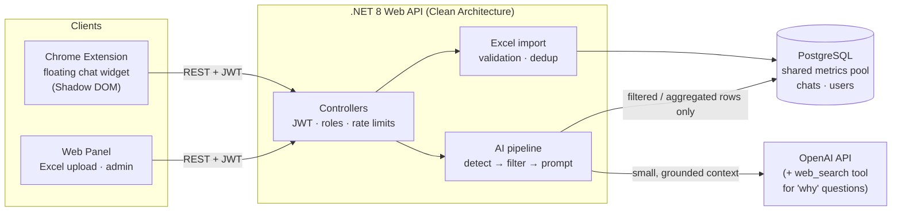
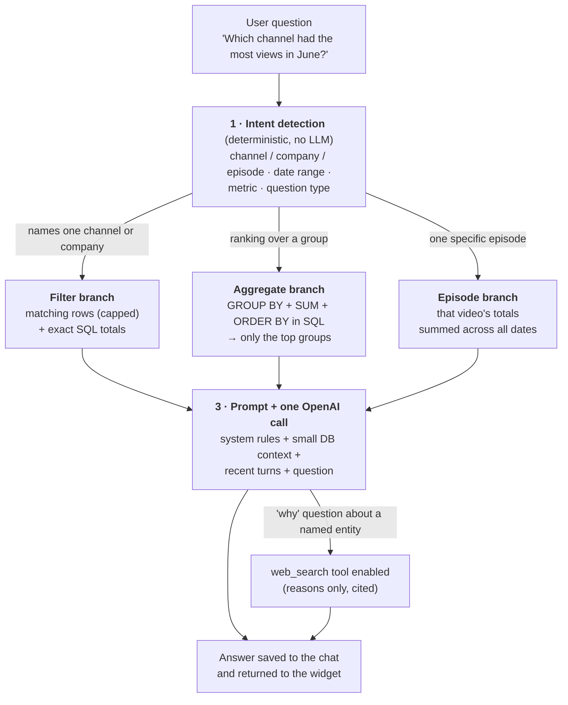

# AI Analytics Assistant: Case Study

**An AI chatbot that answers questions about YouTube performance data, with every number coming from the database and none made up by the model.**

> **About this repository.** I built this product during a software engineering internship at a digital media company (July–August 2026). The source code belongs to the company and stays private, so this repository documents the **problem, architecture, engineering decisions and results** without code, prompts or company data.

---

## At a Glance

| | |
|---|---|
| **Role** | Sole developer: backend, web panel, Chrome extension, tests, deployment docs |
| **Duration** | ~6 weeks, 113 commits |
| **Users** | YouTube account specialists and video editors |
| **Stack** | .NET 8 Web API · PostgreSQL · React + TypeScript + Tailwind · Chrome Extension (MV3) · OpenAI API |
| **Quality** | 300+ xUnit tests, including authorization-matrix, BOLA and rate-limit integration tests |
| **Performance** | ~348,000 requests load-tested with **0 server errors**; filtered queries in **~2 ms** on a 500,000-row table |

## The Problem

The team tracks YouTube performance (views, watch time, likes and revenue per video, channel and company) in Excel exports. Answering a simple question such as *"How did channel X do in June?"* or *"Which company earned the most this quarter?"* meant finding the right file, filtering it and adding up columns by hand.

The goal was to let anyone **ask in plain Turkish and get a correct, data-backed answer**, from any web page they are working on.

Two constraints shaped the design:

1. **Accuracy.** Language models are bad at arithmetic over large tables and will confidently invent numbers. An analytics tool that is wrong 5% of the time is worse than none.
2. **Cost.** The data pool grows to hundreds of thousands of rows. Sending it to the model on every message would be slow and expensive.

## The Solution

Users upload Excel exports into a **shared data pool**. They then chat with an assistant through a **floating widget that the Chrome extension injects into any web page**. A **web panel** handles uploads and admin work.

## How a Question Is Answered

Every message runs the same **three-step pipeline**. The key idea is that **the database does the math and the model does the language**.

## Key Engineering Decisions

### 1. Aggregation happens in SQL, never in the LLM
For ranking questions ("which company earned the most?") the top groups can be only a few percent apart. If the model saw only a truncated sample of rows, it could rank them wrong. Ranking therefore runs as `GROUP BY … SUM(…) ORDER BY … DESC` over **all** matching rows, and the model receives only the small computed result. View and like totals are summed as 64-bit integers to avoid overflow.

### 2. A correctness bug that became an architecture rule
While testing, the assistant reported one day's views of an episode as the episode's *total*: the same video appears on several dates, and the model picked one row instead of adding them up. Instead of tuning the prompt, I added a dedicated **episode branch** that sums the video's rows in SQL. Follow-up questions ("and the revenue?") keep the same episode in scope.

### 3. Strict grounding rules
- **Numbers come only from the database context.** Web search is enabled only for *"why"* questions about a named channel. It may supply a **cited reason**, never a figure.
- When there is no data, the model says *"no data found"* instead of guessing.
- **Arithmetic over the provided rows is required, not forbidden.** An early prompt made the model refuse to add numbers ("I can't sum rows myself"), so the rules now say explicitly that adding up the given rows is allowed and expected.
- **The pipeline never leaks into the answer.** Row counts, filters and SQL branches go to logs only, and users see just the analysis.

### 4. Cost control through filtering, not caching
Step 1 is deterministic and cheap (keyword and date parsing, no LLM call). Each message makes **exactly one** model call with a small context. That avoided vector databases, RAG and caching layers, which kept the system simple.

### 5. Images as untrusted, short-lived input
Users can attach up to 4 cover images per message and ask "how can we improve this thumbnail?".
- **Validation:** images are checked by **magic bytes**, re-encoded and downscaled on the server before reaching the model. Raw user bytes are never forwarded, and nothing is stored.
- **Prompt injection:** text inside an image is treated as data. A cover saying "ignore your rules" changes nothing.
- **Numbers stay database-only**, even if one is printed on the image.
- **Graceful degradation:** if the model rejects images or the web-search call fails, the same turn is retried without them, so the user still gets a data-backed answer.

### 6. Chrome extension built for real-world pages
- **Shadow DOM** isolates the widget's styles from the host page, in both directions.
- **All API calls run in the background service worker**, so host-page CSP/CORS rules do not apply, and a slow answer still arrives **after the panel is closed** (badge + toast notification).
- **JWT in `chrome.storage`**, never `localStorage`.

## Security

| Area | Measure |
|---|---|
| Authentication | JWT; passwords stored only as salted hashes |
| Authorization | Two roles (User / Admin); every `/api/admin/*` endpoint requires Admin |
| Object-level access | Chats are private per user; **BOLA tests** check that one user cannot read another's chat |
| Abuse protection | Rate limits: login per IP, chat per user, a token bucket for image uploads |
| Configuration | Secrets come only from environment variables or user-secrets; the API **refuses to start** if a required value is missing or unsafe (for example a wildcard CORS origin) |
| Uploads | Fixed Excel schema validation; images checked by magic bytes and re-encoded |

## Performance

Measured on a development machine. The ratios and query plans matter more than the absolute numbers.

**Database:** benchmarked on a realistic **500,000-row** table (300 channels × 60 companies × 730 days).
- The composite index `(ChannelName, RecordDate)` serves channel-plus-date filters entirely from the index: **~1.9 ms**.
- `EXPLAIN ANALYZE` showed that company-plus-date queries fell back to a sequential scan, so I **added the missing index** and documented before and after.

**API load test:** written as a dependency-free Node script.

| Scenario | Result |
|---|---|
| Total requests | ~348,000, **0 × 5xx** |
| 50 concurrent users (chat list) | ~15,800 req/s · p95 **6.6 ms** |
| Spike to 100 concurrent | p99 **84.7 ms**, no errors |
| Recovery after spike | back to p50 **2.6 ms** within 2 s |

One finding: the health endpoint was **12× more expensive** than a normal read, because it opens a real database connection each time. I kept it, since it must tell the truth about the database, and documented that monitoring should not probe it more than once per second.

## Testing

- **300+ backend tests** (xUnit), covering intent detection, prompt rules, aggregation branches, Excel import and admin guards.
- **Integration tests** with `WebApplicationFactory` against an in-memory database:
  - **authorization matrix:** every endpoint × every role
  - **broken object-level authorization (BOLA):** cross-user access attempts
  - **rate limiting** behaviour and security headers
- A smoke-test script and a written **go/no-go checklist** for production readiness.

## What I Learned

- **Use the LLM for language, the database for facts.** Most "AI accuracy" problems I hit were solved by moving work out of the model, not by writing longer prompts.
- **Measure before optimising.** `EXPLAIN ANALYZE` and a simple load script found the missing index and the expensive health check, neither of which I would have guessed.
- **Write down the rules.** Keeping architecture decisions in one source of truth, and the deeper topics (pipeline, security, database, API contract) in separate documents, kept six weeks of fast iteration consistent.

---

**Diyar Sari** · [GitHub](https://github.com/DiyarSari) · Source code available for review on request, subject to the company's approval.

